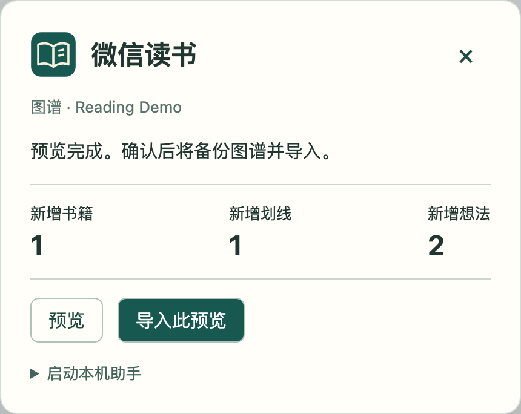

# 微信读书导入 Logseq

**WeRead Notes Import v1.1.0** · macOS · Logseq Desktop **2.0.2** 数据库图谱。使用微信读书官方 API 和 Logseq CLI。其他 Logseq 版本的导入接口尚未验证。

## 从 Logseq 中使用

1. 安装插件和 Logseq CLI，打开目标数据库图谱。在访达按 ⌘⇧G 打开 `~/.logseq/plugins/logseq-reading-import/`。
2. 首次使用双击 `设置微信读书密钥.command` 保存个人 API Key。双击 `启动导入助手.command`，导入期间保持终端窗口打开。
3. 在 Logseq 命令面板或空白块的斜杠菜单选择 **微信读书 · WeRead Notes Import**。点击「预览」核对书籍、划线和想法数量，再点「导入此预览」。助手会备份选中的图谱、导入已预览的内容并核对结果。
4. 完成后在助手窗口按 Ctrl-C 即可退出。插件与助手通过本机 Logseq 的插件存储通信。通过面板生成的预览、备份记录和日志保存在 `~/.local/share/logseq-reading-import/runs/`，密钥只由本机助手使用。

**English:** Preview and import WeRead highlights and personal reviews into the currently open Logseq DB graph. Start the included macOS helper, open **WeRead Notes Import** in the command palette, preview the counts, then confirm the import. A backup is made before each write. Source IDs preserve existing edits across repeated imports.



下载 [GitHub 安装包](https://github.com/hzphzp/logseq-reading-import/releases/latest) 也可独立使用下列命令行方式。

## 微信读书

- 双击 `预览微信读书.command`：读取微信读书笔记，显示新增数量，不修改图谱。
- 双击 `同步微信读书.command`：读取有笔记的书、完整划线、个人想法及整本书评；创建图谱备份后补入缺失记录。
- 运行时保持 Logseq 打开，并打开目标图谱。双击脚本时默认使用 `logseq_base_v2`，其他图谱可在终端运行 `python3 weread_import.py --graph 图谱名` 预览，确认后加上 `--apply` 同步。首次完整读取可能需要几分钟，窗口会显示进度。
- 官方接口的“书签”指阅读位置，不提供内容；不会伪装成划线导入。
- 同步只导入有笔记的书，不会把整个书架里的未阅读书籍批量建成空页面。

正文模板：书籍页面下使用普通标题 `简介`、`笔记`；按章节组织划线。无章节的个人点评放在 `想法与书评`。学科/书籍分类保留完整名称，不按逗号拆分。

作者、出版社、分类等是原生属性。书籍 ID、划线 ID、想法 ID、章节 ID、位置和内部章节标识保存在隐藏属性中，不追加到摘录正文。原图谱已有属性会被复用，不改变它们的类型。

按书籍 ID + 划线/想法 ID 查重，同时为新记录生成固定 UUID。再次运行不会覆盖已经导入的正文、用户改过的书名或手写笔记；不会因为微信读书删除了记录而删除 Logseq 内容。已有非空元数据也不会被覆盖。

### 凭据和日志

使用腾讯官方 [WeChatReading 接口](https://github.com/Tencent/WeChatReading)。密钥只从 `WEREAD_API_KEY` 环境变量或本机 `~/.config/logseq-import/weread-api-key` 读取，不上传到 Logseq 图谱、不放进 Git、不在日志里打印。获取入口：<https://weread.qq.com/r/weread-skills>。

密钥设置助手随安装包提供。

运行记录在 `runs/时间/`，包含来源数据、预览、备份位置和完成校验。这些文件含私人笔记，已被 `.gitignore` 排除。官方接口提示升级时会停止，先核对官方文档再更新 `VERSION` 和相关适配。

### 指定一本书

```sh
python3 weread_import.py --book-id 书籍ID
python3 weread_import.py --book-id 书籍ID --apply
```

`--input 来源文件.json` 可重放一次完整读取；默认预览，必须加 `--apply` 才写入。中途失败时不会删除已经完成的记录，修复后重跑按来源 ID 继续。

### 验证

```sh
python3 -m unittest -v test_weread.py
```

测试会创建独立、不同步的临时图谱，验证原生属性、日期、正文、标签名称、重复导入和本地修改后的保留行为。测试结束关闭测试 worker，保留临时图谱供检查。

Zotero 文献导入使用独立的 [Zotero Local 插件](https://github.com/hzphzp/logseq-zoterolocal-plugin/releases/tag/v3.5.6-clean.2)。

## 恢复

每次微信读书实际导入前调用 `logseq graph backup create`。具体备份路径保存在本次 `runs/.../backup.json`。如需回退，先备份当前图谱，再使用 Logseq 官方备份恢复；不要直接覆盖正在打开的 `db.sqlite`。
